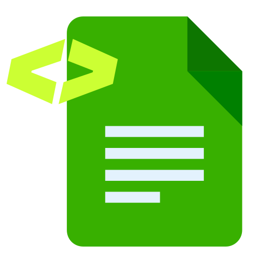

# DocuWriter.ai for Claude

DocuWriter.ai generates, organizes, and maintains complete documentation for entire codebases. This plugin connects Claude to your DocuWriter.ai account and adds skills that teach Claude the DocuWriter workflow: Full Tree Documentation for a connected repository, Spaces where the team searches and edits the result, and Autopilot, which proposes documentation updates when the code changes.

It works in Claude chat, Cowork, and Claude Code.

## What's included

- **DocuWriter.ai connector**: the hosted DocuWriter MCP server at `https://app.docuwriter.ai/mcp`. Its tools generate documentation, READMEs, release notes, UML diagrams, and OpenAPI specs; search and edit Spaces; and review Autopilot suggestions.
- **Skills**:
  - `docuwriter-overview` introduces DocuWriter's Full Tree Documentation, Spaces, and Autopilot.
  - `docuwriter-documentation-lifecycle` walks through the path from repository connection to maintained documentation.
  - `docuwriter-official-docs` finds and cites the official DocuWriter Platform Docs for setup and how-to questions.

## Install

In claude.ai or Cowork, open **Customize > Plugins**, find DocuWriter.ai in the directory, and add it. Then connect the DocuWriter.ai connector from the plugin's **Connectors** tab and sign in with your DocuWriter.ai account.

In Claude Code, install the plugin from this repository's marketplace:

```bash
claude plugin marketplace add DocuWriter-ai/claude-plugin
claude plugin install docuwriter@docuwriter
```

The first time Claude calls a DocuWriter tool, your browser opens to sign in. Claude Code shows the connection state under `/mcp`.

## Use it

Ask Claude in plain language. For example:

- "Show the documentation Spaces in my DocuWriter account."
- "Search my DocuWriter docs for how authentication works in the API service."
- "Generate a README for my imported repository."
- "List pending Autopilot suggestions for the Backend Space. Don't apply them."
- "How do I connect a Space to Autopilot? Link the official guide."

Claude asks before it calls a tool that changes data, such as creating a page, applying an Autopilot suggestion, or deleting a Space.

## Requirements

You need a [DocuWriter.ai account](https://www.docuwriter.ai). A free trial is available. Some actions happen only on the DocuWriter.ai website: connecting GitHub, GitLab, Bitbucket, or Azure DevOps; importing a repository; billing; and account security.

## Data

The plugin itself contains only Markdown skills and a connector reference. It runs no local code and stores nothing on your machine.

When Claude calls a DocuWriter tool, the request goes to `app.docuwriter.ai` over HTTPS and is authorized with your own DocuWriter.ai account through OAuth. Depending on the tool, the request contains the code, document content, or search query you asked Claude to work with. DocuWriter processes that data under its [Privacy Policy](https://app.docuwriter.ai/privacy-policy) and [Terms of Service](https://app.docuwriter.ai/terms-of-service). The plugin sends no data to any other service.

## Support

For help, see the [DocuWriter Platform Docs](https://docs.docuwriter.ai) or email support@docuwriter.ai.

## License

MIT. See [LICENSE](LICENSE).
